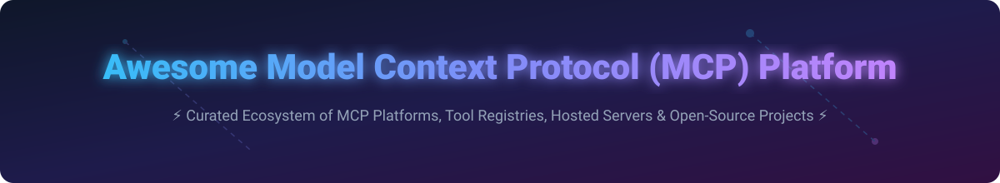

  

# 🚀 Awesome Model Context Protocol (MCP) Platform

  
  
  
  
  
  

> ⚡ **Curated List of SaaS Products, Hosted MCP Platforms, & Open-Source GitHub Projects**  
> *Focused on Model Context Protocol Servers, Tool Registries, Remote MCP Hosting, Agent Infrastructure & Secure AI-to-System Connectivity.*  
> **Last updated: September 2026**

---

## 📌 Table of Contents
- [💡 Overview](#-overview)
- [🌐 SaaS / Hosted Platforms](#-saas--hosted-platforms)
- [🔓 Open-Source GitHub Projects](#-open-source-github-projects)
- [🛠️ How to Contribute](#️-how-to-contribute)
- [⚠️ Disclaimer](#️-disclaimer)
- [❤️ Support & Sponsorship](#️-support--sponsorship)
- [📈 Star History](#-star-history)

---

## 💡 Overview

The **Model Context Protocol (MCP)** is an open standard originated by Anthropic that enables AI models and autonomous agents to securely connect to external tools, databases, APIs, and enterprise systems via a standardized client-server protocol.

This repository tracks top commercial hosted platforms, enterprise registries, and leading open-source repositories driving the MCP ecosystem forward.

---

## 🌐 SaaS / Hosted Platforms

> 📊 **Sector Market Size & Structure**:  
> The estimated market size for AI Agent Infrastructure & MCP Orchestration Platforms is **$3.5 Billion in 2026** (projected to reach **$18.5 Billion by 2030** at a 51.6% CAGR).  
> The market is currently **highly fragmented**, characterized by rapid innovation across startup tooling, cloud providers (Cloudflare, AWS, Azure), automation platforms (Zapier, Pipedream), and identity vendors (Stytch, WorkOS).

Below is a curated comparison table of commercial & hosted MCP platforms, sorted by **Company Valuation / Revenue** in descending order:

| 🏢 Platform / Company | 💰 Valuation / Est. Revenue | 💳 Starting Tier Pricing | 🆓 Free Tier / Trial Limit | 📝 Key Features & Description |
| :--- | :--- | :--- | :--- | :--- |
| **[Zapier MCP](https://zapier.com/)** | **$5.0B Valuation** | $19.99 / month (Professional) | Free forever (100 tasks/month, 5 single-step Zaps) | Exposes 7,000+ app integrations as agentic MCP tools for enterprise workflow automation. |
| **[Cloudflare MCP](https://developers.cloudflare.com/)** | **$3.1B Revenue** | $5.00 / month (Workers Paid) | Free forever (100k requests/day, Workers free tier) | Edge-deployed MCP servers, serverless hosting, and secure MCP remote access portals. |
| **[WorkOS MCP](https://workos.com/)** | **$1.2B Valuation** | $99.00 / month (Growth Plan) | Free forever (Up to 1,000 MAUs for SSO & Auth) | Enterprise identity management, SSO, and Directory Sync for enterprise MCP agent access. |
| **[Stytch MCP](https://stytch.com/)** | **$1.0B Valuation** | $99.00 / month (Standard) | Free forever (Up to 10,000 free monthly active users) | Developer-first identity, authentication, and RBAC policy enforcement for MCP server tools. |
| **[Composio](https://composio.dev/)** | **$350M Valuation** | $29.00 / month (Starter Plan) | Free forever (1,000 tool executions/month) | Managed tooling platform with 250+ pre-built tool integrations & production agent sandboxes. |
| **[Pipedream MCP](https://pipedream.com/)** | **$150M Valuation** | $19.00 / month (Basic Plan) | Free forever (100 credits/day, ~3,000 credits/month) | Developer-centric workflow integration engine exposing thousands of APIs to MCP clients. |
| **[Mintlify MCP](https://mintlify.com/)** | **$120M Valuation** | $120.00 / month (Pro Plan) | Free forever (1 project, standard docs hosting) | Automated documentation indexing & contextual search servers for AI coding assistants. |
| **[Smithery](https://smithery.ai/)** | **$45M Valuation** | $15.00 / month (Developer Pro) | Free forever (Up to 3 hosted MCP servers, public registry access) | Specialized registry and hosting infrastructure for discovering and deploying MCP servers. |
| **[Toolhouse](https://www.toolhouse.ai/)** | **$30M Valuation** | $49.00 / month (Pro Tier) | Free forever (500 execution minutes/month) | Serverless cloud execution platform for agent functions, tool calling, and MCP hosted servers. |
| **[MCP.run](https://mcp.run/)** | **$15M Valuation** | $10.00 / month (Hobbyist) | Free forever (10k invocations/month, 2 active servers) | Lightweight edge runtime and proxy hosting for community and custom MCP tools. |

---

## 🔓 Open-Source GitHub Projects

Below is a curated, expanded list of leading open-source repositories powering the MCP ecosystem, sorted by **GitHub_Stars** in descending order.

| 📦 Repository & Link | ⭐ GitHub_Stars | 📜 Description |
| :--- | :--- | :--- |
| **[Playwright Browser Automation](https://github.com/microsoft/playwright)** |  | Official web automation library powering browser control MCP servers. |
| **[Model Context Protocol Specification & SDKs](https://github.com/modelcontextprotocol)** |  | Official open standard specification, TypeScript SDK, Python SDK, and core architecture. |
| **[Official MCP Reference Servers](https://github.com/modelcontextprotocol/servers)** |  | Standard reference MCP servers for filesystem, Git, Postgres, SQLite, Slack, and Google Drive. |
| **[LangChain MCP Adapters](https://github.com/langchain-ai/langchain)** |  | Tooling and adapters for connecting LangChain agent workflows seamlessly to MCP servers. |
| **[LlamaIndex MCP Tools](https://github.com/run-llama/llama_index)** |  | Data framework enabling LlamaIndex agents to query external tools via Model Context Protocol. |
| **[FastMCP (Python MCP SDK)](https://github.com/jlowin/fastmcp)** |  | High-level Python framework for building production-ready MCP servers with minimal boilerplate. |
| **[MCP Inspector](https://github.com/modelcontextprotocol/inspector)** |  | Interactive developer testing tool and GUI for inspecting, debugging, and testing MCP servers. |
| **[Glama MCP Registry](https://github.com/glama-ai/mcp-server-list)** |  | Open index and catalog containing thousands of community-contributed MCP servers. |
| **[Postgres MCP Server](https://github.com/modelcontextprotocol/servers/tree/main/src/postgres)** |  | Open-source MCP server allowing AI agents to securely query and inspect PostgreSQL databases. |
| **[Awesome-Awesome-Awesome](https://github.com/ishandutta2007/Awesome-Awesome-Awesome)** |  | Ultimate curated collection of awesome lists across AI, developer tools, and open source ecosystems. |
| **[Hyperconsciousness](https://github.com/louis030195/hyperconsciousness)** |  | Developer-alpha Rust knowledge store with encrypted, append-only records and scoped, expiring MCP grants for agent access. |
| **[NeverApply MCP](https://github.com/kasovy/neverapply-mcp)** |  | Hosted MCP job-search agent: search and match jobs, tailor resumes, prep interviews, and apply with approval. |

---

## 🛠️ How to Contribute

Contributions are very welcome! To add or update a hosted platform or open-source repo:

1. 🍴 **Fork** this repository.
2. 📝 **Edit** `README.md` following the tabular format and inclusion criteria.
3. 🔍 Ensure pricing details, free tier limits, Stars_Badges, and links are fully factual and accurate.
4. 🚀 **Submit** a Pull Request with a clear title and description.

---

## ⚠️ Disclaimer

- This is a **community-curated index** for informational and educational purposes.
- Model Context Protocol grants AI tools access to local and remote infrastructure. Always review permissions, security policies, and code before connecting third-party MCP servers to critical data.

---

## ❤️ Support & Sponsorship

If you find this repository helpful for building, researching, or deploying Model Context Protocol platforms and servers, please consider supporting the project!

- ⭐ **Star** this repository to help others discover it.
- 🔄 **Fork** and share with your fellow AI engineers and platform teams.
- ☕ **Sponsor / Buy me a coffee**: Support ongoing maintenance and curation on the [GitHub Sponsor Dashboard](https://github.com/sponsors/ishandutta2007).

---

## 📈 Star History

---

  <b>Built for AI engineers, agent developers, and platform teams building the future of Model Context Protocol.</b>

